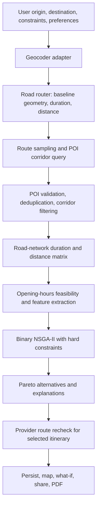

# RAHGIR — Road-trip intelligence for India

**Product premise:** *Maps you along the road. Rahgir helps you decide what is worth discovering on the way.*

Rahgir is an evidence-aware road-trip discovery and itinerary-planning application. Its core is a deterministic, testable route-planning pipeline—not an LLM wrapper. It combines road-network routing, route-corridor POI discovery, road-network detour matrices, hard itinerary constraints, a binary NSGA-II multi-objective search, source provenance, and explicit uncertainty handling.

> **Important status statement:** This repository is a working research prototype. Live provider adapters are implemented, but this build environment had no outbound DNS/network access, so the five named Indian city-pair routes were not validated against live providers or on the ground. The offline walkthrough is synthetic, conspicuously labelled, and must never be used for navigation, safety decisions, real POI claims, or research outcome data. The paper draft reports only the synthetic optimisation benchmark and clearly states the limitations.

## Version 2 experience

Rahgir now has a journey workspace in addition to the public landing page. The reference workflow is covered by a route-creation form, multi-select travel interests, a split itinerary/map experience, stop story cards, dashboard navigation, saved journeys, a browser-local travel journal, and a trip-aware conversation panel. The map and itinerary remain connected: selecting a Pareto alternative redraws the selected stop route where the route provider supports it. A Google Maps directions link is shown for live-provider trips only; it is suppressed for synthetic fixtures.

Stop story/photo enrichment is opt-in and conservative: it runs only when an OpenStreetMap POI includes an explicit `wikipedia=en:...` tag. Rahgir does not fuzzy-match place names or invent a story/photo. A place without a linked article is shown with an explicit no-source-context message. Thumbnail URLs are restricted to Wikimedia upload hosts and the article link is shown with the card.

The trip assistant works without a key using deterministic answers from the saved trip record. Set `OPENROUTER_API_KEY` to enable optional OpenRouter-assisted phrasing; the model receives the trip record as untrusted grounding data, is instructed not to fill evidence gaps, and falls back to local rules if the optional service fails. The route planner and optimizer never depend on the LLM.

Saved journeys are a browser-local index of server trip IDs; journal entries are stored in browser local storage. This is not a synced account or durable cloud backup. On the current Render free preview, the backend SQLite database is ephemeral, so a saved trip may stop reopening after a service restart. Do not treat these local convenience features as production account persistence.

## What is implemented

- **Live-provider route planning:** Nominatim geocoding; OSRM or OpenRouteService directions and duration/distance matrix; Overpass POI discovery in a route corridor.
- **Route-aware candidates:** coordinates are validated, POIs outside the configurable route corridor are removed, duplicate OSM IDs are removed, and each POI retains its source URL, raw tags and retrieval timestamp.
- **Actual detour calculation:** candidates are assessed with a directed road-network time/distance matrix. The full ordered itinerary is evaluated against detour, total journey time and stop-count hard constraints.
- **Second route verification:** the selected itinerary is sent back through the route provider, and provider-returned duration/distance are checked again against the user constraints. A failed or unavailable recheck is not represented as a verified route.
- **Multi-objective engine:** custom seeded binary NSGA-II; six objectives; Pareto alternatives labelled Balanced, Fastest, Culture-rich, Explorer and Food trail when those alternatives are distinct. A bounded discovery/efficiency dial selects among already-feasible Pareto options; it does not change the optimizer objectives or relax constraints.
- **Explainable candidate explorer:** each mapped candidate receives a directed single-stop road-matrix check, estimated arrival and supported opening-hours state. The UI separates individually blocked candidates from feasible candidates not selected in the combined itinerary. Single-stop feasibility is never presented as combined-itinerary feasibility.
- **Human-friendly planning controls:** travel-mood chips, progressive advanced settings, explicit detour/time/stop budgets, a journey timeline, responsive candidate filters, and “Why this place?” / “Why not this place?” explanations.
- **Functional what-if:** users can change detour budget, discovery preference and departure timestamp. The backend reruns the planner; a changed departure recalculates estimated arrivals and supported opening-hours checks.
- **Temporal handling:** a deliberately small, safe subset of OSM `opening_hours`; definite closed results are excluded; unsupported formats and missing hours remain `unknown`.
- **Uncertainty safeguards:** no safety score is inferred from missing reports; incomplete data is labelled insufficient. Metadata completeness is not treated as source truth or confidence.
- **Community reports:** submissions, rate limiting, near-duplicate flagging, admin moderation, evidence URL required before marking a report verified, audit-relevant fields. Reports do not feed a road-safety score.
- **Trip persistence and actions:** local SQLite storage, actual what-if recomputation, selected-stop route preview, token-hashed read-only share links with revocation, PDF itinerary export.
- **Research harness:** deterministic synthetic instances, exact Pareto reference front for small instances, NSGA-II and simple baselines, hypervolume/IGD, cluster bootstrap intervals and exact paired sign-flip inference. Synthetic and live data are separate.
- **Responsive web UI:** editorial landing page and application-style workspace with Dashboard / Routes / Saved / Journal / AI Assistant navigation; responsive split map and itinerary; multi-select theme chips; source-linked stop photos/story cards when explicit Wikipedia metadata exists; trip Q&A; browser-local saved journey and journal views; editable route filters; editorial travel-focused visual system; route map with attribution when Leaflet/tile service loads; explicit schematic fallback and warning when map tiles/library are unavailable; Pareto persona cards; route-pulse timeline; “Why / why not?” decision explanations; filterable candidate explorer; report form; read-only sharing and PDF export. The map fallback updates route state too, so unavailable tiles are not mistaken for a live map.

## Not implemented yet — do not imply otherwise

The supplied master build prompt lists a much wider roadmap than can be truthfully claimed as complete in this build. The following remain future work: authenticated user accounts and server-synced preferences; durable production database and persistent media storage; complete dynamic rerouting from verified incidents; validated road-segment safety datasets and heatmaps; actual weather/festival/crowd feeds; fuel/EV/restroom/hospital facility search; emergency mode; image-upload and image moderation; voice and multilingual assistant; vector search/RAG over a maintained knowledge base; full permutation-aware stop-order optimisation; full adaptive urban/rural POI sampling; provider-backed base-route alternatives; dedicated admin UI; user studies and field validation. The backend currently uses SQLite. No LLM is used in the route planning or ranking path; the optional chat layer is separate.

## Quick start (Windows PowerShell)

1. Install Python 3.11+ (3.13 is also supported by this prototype) and Git.
2. Open PowerShell in the repository root:

```powershell
py -3 -m venv .venv
.\.venv\Scripts\Activate.ps1
python -m pip install --upgrade pip
pip install -r requirements-dev.txt
Copy-Item .env.example .env
```

3. Edit `.env`. At minimum set a real identifying `HTTP_USER_AGENT` contact string before using public OpenStreetMap services. For production/repeated usage, select a hosted or self-hosted router and POI/geocoder service in accordance with their terms.
4. Start the server:

```powershell
$env:PYTHONPATH = "backend"
uvicorn app.main:app --app-dir backend --env-file .env --host 127.0.0.1 --port 8000 --reload
```

5. Open `http://127.0.0.1:8000`. API docs are at `http://127.0.0.1:8000/api/docs`.

An offline walkthrough is available from the page using the **Try synthetic walkthrough** control. Choose one of the five illustrative pairs. The result is synthetic and prominently marked.

### Quick start (macOS/Linux)

```bash
python3 -m venv .venv
source .venv/bin/activate
python -m pip install --upgrade pip
pip install -r requirements-dev.txt
cp .env.example .env
set -a && source .env && set +a
PYTHONPATH=backend uvicorn app.main:app --env-file .env --host 127.0.0.1 --port 8000 --reload
```

## Environment variables

See [`.env.example`](.env.example) for the full list. Core settings:

| Variable | Default | Purpose |
|---|---|---|
| `ROUTING_PROVIDER` | `osrm` | `osrm` or `ors` |
| `ORS_API_KEY` | empty | Required for ORS routing/matrix calls |
| `OPENROUTER_API_KEY` | empty | Optional trip assistant; omit for deterministic local answers |
| `OPENROUTER_MODEL` | `openrouter/auto` | Optional model routing for the chat layer |
| `OPENROUTER_BASE_URL` | OpenRouter API | Optional chat API base URL |
| `WIKIPEDIA_ENRICHMENT` | `true` | Fetch article context only for explicit OSM Wikipedia tags |
| `GEOCODER_PROVIDER` | `nominatim` | Currently supported geocoder |
| `NOMINATIM` / `GEOCODER_BASE_URL` | public endpoint | Configurable base URL |
| `OVERPASS_URL` | public Overpass instance | Configurable POI endpoint |
| `HTTP_USER_AGENT` | placeholder | Set an identifying app name and real operator contact |
| `CORRIDOR_RADIUS_M` | `2500` | Maximum POI distance from route polyline |
| `MAX_POIS` | `14` | Candidate cap (matrix adapter supports at most 23 candidates plus endpoints) |
| `NSGA_POPULATION` | `64` | NSGA-II population |
| `NSGA_GENERATIONS` | `60` | NSGA-II generations |
| `DATABASE_URL` | local SQLite | SQLAlchemy database URL |
| `ADMIN_TOKEN` | empty | Required to moderate reports |
| `ALLOW_DEMO` | `true` | Enable/disable synthetic walkthrough |

The public OSRM demo endpoint is best-effort and not a production SLA. Public Nominatim has a strict usage policy (including a one-request-per-second limit, attribution, caching, and restrictions on autocomplete/bulk use). Public Overpass instances are shared infrastructure. Do not scale this default configuration for a public launch. See [provider policies](docs/DATA_SOURCES.md).

## Core workflow



## API surface

Base path: `/api/v1`

| Method | Endpoint | Purpose |
|---|---|---|
| `GET` | `/health` | Process readiness and configured provider names (not a provider probe) |
| `GET` | `/demo/cases` | Synthetic case catalogue |
| `POST` | `/trips/plan` | Live route planning |
| `POST` | `/demo/plan?case_id=...` | Synthetic offline walkthrough |
| `GET` | `/trips/{trip_id}` | Retrieve stored trip |
| `POST` | `/trips/{trip_id}/what-if` | Recompute with changed constraints |
| `POST` | `/trips/{trip_id}/replan` | Recompute original plan |
| `POST` | `/trips/{trip_id}/route-preview` | Route the selected stop sequence through provider |
| `POST` | `/reports` | Submit a community report |
| `GET` | `/reports` | List recent reports (optionally filter by coordinates/radius) |
| `POST` | `/reports/{id}/moderate` | Admin moderation; `X-Admin-Token` required |
| `POST` | `/trips/{trip_id}/share` | Create read-only share token |
| `GET` | `/shared/{token}` | Read shared trip JSON |
| `DELETE` | `/trips/{trip_id}/share/{token}` | Revoke share token |
| `GET` | `/trips/{trip_id}/export.pdf` | Download trip PDF |
| `GET` | `/research/experiments` | Research protocol metadata |

## Run tests

```powershell
$env:PYTHONPATH = "backend"
pytest -q
```

The test harness creates a separate temporary SQLite database and uses mocked HTTP provider responses. It does not hit public APIs. The current suite includes geometry, temporal parsing, NSGA-II determinism/dominance, discovery-bias boundary and behavior, malformed provider data, route recheck logic, five synthetic route walkthroughs, report deduplication/moderation, share/revoke, PDF export and what-if recomputation including departure-time propagation.

## Run the research benchmark

```powershell
pip install -r requirements-research.txt
python research\run_experiments.py --seeds 5 --instances 8 --candidates 12 --population 64 --generations 60 --output research\results\paper_benchmark
python research\plot_results.py
```

Output:

- `synthetic_benchmark.csv` — raw per-instance/per-seed metrics.
- `summary.json` — parameters, means, paired cluster-bootstrap confidence intervals, exact sign-flip p-values.
- `summary.md` — human-readable results and interpretation constraints.
- `figures/` — per-instance boxplots for hypervolume, IGD and runtime (the five seeds are averaged within each instance).
- `research/plot_results.py` — reproduce the result figures from the CSV.

The exact reference Pareto front is obtained by exhaustive enumeration. Keep the candidate count small (maximum 12 in the supplied runner). Do not enlarge this limit without changing the reference-front implementation. Run all variants on the same synthetic instances and seeds. The included baselines are simple engineering baselines, not state-of-the-art TTDP methods. The inference procedure averages optimizer seeds within each instance and treats the instance—not each repeated seed—as the independent sampling unit.

## Research paper

- Draft (PDF): [`research/paper/rahgir_paper_draft.pdf`](research/paper/rahgir_paper_draft.pdf)
- Draft source: [`research/paper/rahgir_paper_draft.tex`](research/paper/rahgir_paper_draft.tex)
- References: [`research/paper/references.bib`](research/paper/references.bib)
- Protocol: [`research/experiment_protocol.md`](research/experiment_protocol.md)
- Related work notes: [`research/related_work.md`](research/related_work.md)
- Dataset dictionary: [`research/data_dictionary.md`](research/data_dictionary.md)
- Synthetic benchmark outputs: [`research/results/paper_benchmark/`](research/results/paper_benchmark/)
- Dataset card: [`research/DATASET_CARD.md`](research/DATASET_CARD.md)
- Verification report: [`docs/TEST_REPORT.md`](docs/TEST_REPORT.md)
- User experience specification: [`docs/UX_AND_PRODUCT_DESIGN.md`](docs/UX_AND_PRODUCT_DESIGN.md)

The manuscript is a **research draft**, not a publication-ready accepted paper. It discloses the eight synthetic instances and no live/field validation. The user-facing discovery/efficiency control is described as a post-Pareto decision preference, not a new optimizer; its usability benefit is not claimed until a participant study is conducted. Figures can be regenerated with `python research/plot_results.py`. Before submission: conduct a broader systematic literature review; add fair GRASP/ILS/VNS/MCTS/TTDP baselines; collect permitted route snapshots; obtain human relevance labels with an annotation rubric; perform route/POI field validation; obtain ethics approval for any participant study; report confidence intervals and failures; supply the corresponding author contact and review data licence and venue rules. Do not turn the synthetic fixtures into purported Indian travel observations.

## Limitations and safety

- Provider routes are estimates, not turn-by-turn navigation; traffic, tolls, road closures, vehicle access and local conditions may differ.
- Mapped POIs/opening hours can be incomplete or stale; verify before travelling.
- The current cultural-value mapping is a documented heuristic, not a validated measure of cultural significance.
- Category rarity in one corridor is a novelty proxy, not proof of a hidden gem.
- `metadata_completeness` is source-field coverage, not factual confidence.
- Community reports are observations, not ground truth. A moderator-supplied source URL is required for a `verified` status, but verification still does not become a road-risk probability.
- No road is labelled safe because no incident was found. Current safety status is always `insufficient_evidence`.
- The family and travel-mood modes are preference presets, not accessibility or safety certifications.
- Candidate fit and cultural signals are based on current mapped tags and fixed heuristics; they are not verified cultural quality labels.
- Do not operate the UI while driving. Plan before departure and use a passenger for interaction.

## Development structure

```text
backend/app/
  engine/       geometry, temporal checks, evidence states, NSGA-II, itinerary planner
  services/     OSRM/ORS/Nominatim/Overpass and synthetic demo providers
  static/       responsive browser application
  main.py       FastAPI routes, persistence actions, PDF export
research/       experiment runner, protocol, dataset dictionary, paper draft
scripts/        local run/verification helpers
 tests/         automated unit and API integration tests
```

### Optional browser smoke test

Install the optional browser-test dependency and a Chromium browser:

```bash
pip install -r requirements-e2e.txt
python -m playwright install chromium
python scripts/browser_smoke.py --screenshot /tmp/rahgir-mobile.png --desktop-screenshot /tmp/rahgir-desktop.png
```

This test executes the real HTML/CSS/JavaScript in Chromium and routes the app's API requests into FastAPI's in-process test client. It deliberately intercepts public CDNs and map tiles, so it validates the offline UI/fallback path and core user interactions, not external map rendering.

## Deployment

A Render Blueprint is included in [`render.yaml`](render.yaml); see [`DEPLOYMENT.md`](DEPLOYMENT.md) before applying it. The currently deployed free preview has `GEOCODER_PROVIDER=disabled` until a real operator contact is configured; use the synthetic walkthrough to inspect the product without claiming live location data. The included free-tier preview uses ephemeral SQLite under `/tmp`, so persisted trips/reports/share links can disappear on service restart or redeploy. Do not use this configuration for durable production usage. Live public map providers remain rate-limited and best-effort; configure a valid operator contact in `HTTP_USER_AGENT` before live geocoding.

GitHub Actions CI is configured in `.github/workflows/ci.yml` to run pytest and validate the browser JavaScript syntax on pushes and pull requests to `main`.
